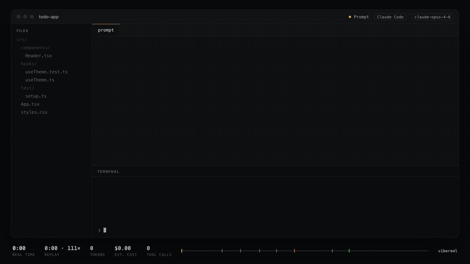

# vibereel

Turn your last Claude Code or Codex session into a 30-second film you can actually share.



That's a 47-minute session squeezed into 30 seconds: the prompt, the plan, the edits, a failing test run, the fix, and the green run. ([MP4](assets/demo.mp4) · [interactive HTML](assets/demo.html))

```sh
npx vibereel
```

Run it inside a project you've used Claude Code or Codex in. You get one self-contained `vibereel-<id>.html` file. Open it in any browser, or drop it anywhere you'd host a static page. No CDN, no tracking, nothing to install for the viewer.

Want a video for X, Slack or a PR?

```sh
npx vibereel --gif --mp4
```

## What's in the film

- your prompt, typed out
- the agent's plan, when it made one
- a file tree that lights up as files get read and changed
- diffs sliding in, with green and red where they belong
- a terminal running the commands, with a red to green test badge when a broken run gets fixed
- live counters for real time, tokens and an estimated cost
- an end card with the totals

It doesn't play everything back. It picks the moments that tell the story (the first prompt, the biggest edits, red to green runs, the final message), skips the noise (`ls`, re-reads, tiny chatter) and fits them into the length you ask for.

Three themes: `dark` (default), `light` and `retro`. Two shapes: `16:9` and `9:16` for phones. In the HTML player, press `space` to pause, `←`/`→` to scrub, `t` to switch themes and `a` to switch aspect.

## Privacy

Session logs are private, so vibereel is careful with them.

- **It runs only on your machine.** Nothing is uploaded. The HTML file is the only output, plus the GIF/MP4 if you ask for them.
- **Redaction is on by default.** Your home folder becomes `~`. API keys (Anthropic, OpenAI, GitHub, AWS, Stripe, Slack, Google and more), JWTs, bearer tokens, passwords in URLs, `SECRET=...` style assignments and email addresses are masked. Every value in `.env` files is blanked.
- **Long output is cut.** Command output and file contents are trimmed to what fits on screen anyway.

Pattern matching can't catch everything. Watch your reel once before you post it. `--no-redact` turns redaction off if the session is yours to show.

## Options

```
npx vibereel [options]

  --list             recent sessions for this folder (add --all for every project)
  --session <id>     pick a session by id or id prefix
  --file <path>      render a specific .jsonl file
  --out <file.html>  where to write the player (default: vibereel-<id>.html)
  --theme <name>     dark | light | retro
  --aspect <ratio>   16:9 | 9:16
  --duration <sec>   target length, 8-180 (default 30)
  --gif, --mp4       also export video next to the HTML
  --open             open the result when done
  --no-redact        keep paths, emails and secrets as they are
  --json             also write the normalised timeline JSON
```

Exporting video needs Chrome (or Chromium, Edge or Brave) and `ffmpeg` on your machine. vibereel finds them on its own; set `CHROME_PATH` if it doesn't. If either is missing, it tells you and still writes the HTML.

Sessions are read from `~/.claude/projects` and `~/.codex/sessions`. `CLAUDE_CONFIG_DIR` and `CODEX_HOME` are respected.

## What it doesn't do yet

- Cursor, Aider, Gemini CLI and other agents. The timeline format is shared, so a parser is the only missing piece. PRs welcome.
- Cost is an estimate from public list prices. It won't match your bill exactly, and subscription plans don't pay per token anyway.
- Subagent work is skipped; only the main conversation is shown.
- Line numbers in diffs are relative to the edited snippet, not the real file.
- Video export takes about a minute, because it renders each frame in headless Chrome.
- Redaction is pattern-based. It's good, not perfect.

## Development

```sh
npm install
npm test          # vitest, synthetic fixtures only
npm run demo      # rebuilds assets/demo.* from fixtures/demo-dark-mode.jsonl
```

The demo session in `fixtures/` is written by hand (`node fixtures/make-demo.mjs`). No real transcripts live in this repo.

## License

MIT
